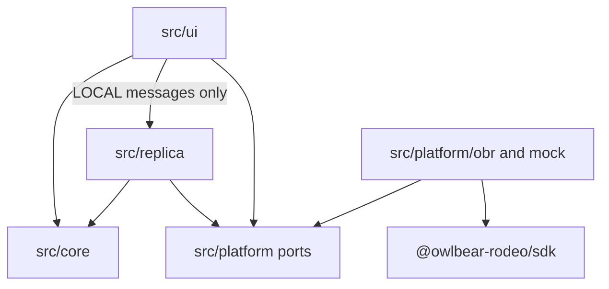
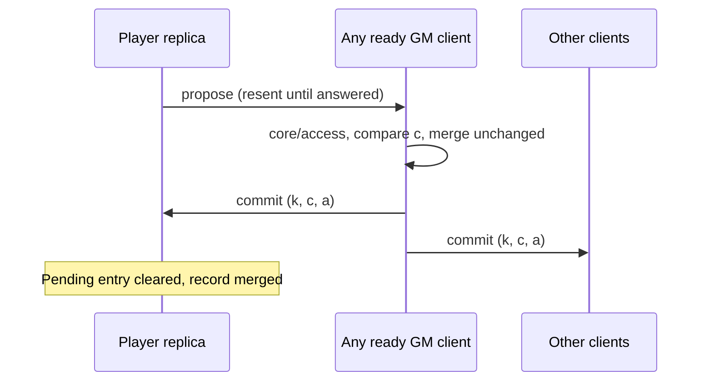
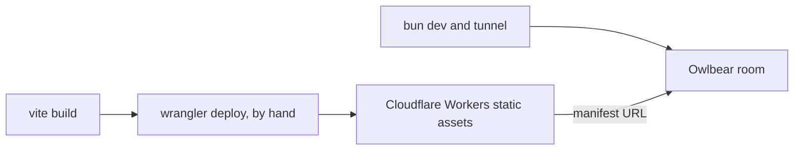

# Architecture Spine — Muster Roll

## Design Paradigm

Every client holds a replica of the room as a map of records. Replicas converge through one merge function. Merge is commutative, associative and idempotent, so duplicates, reordering and full-state resends are harmless. No client is a leader.

Code is a functional core with ports and adapters:

| Layer | Directory | Holds |
| --- | --- | --- |
| Core | `src/core` | Records, merge, access check, visibility, preset schema, formula parser, snapshot codec. Pure, with no DOM or SDK |
| Replica | `src/replica` | The engine in the background page. Owns the replica, protocol, catch-up and snapshot timing |
| Platform | `src/platform` | Ports for broadcast, metadata, party, player, storage, context menu and popover. The Owlbear adapter and the test mock |
| UI | `src/ui` | React views and nanostores. A projection of the replica |



## Invariants & Rules

### AD-1 — Peer replicas [ADOPTED]

- **Binds:** CAP-1, CAP-11, all clients
- **Prevents:** A leader whose frozen tab stalls the room.
- **Rule:** All GM clients are equal. No code elects, tracks or waits for a specific GM client.

### AD-2 — The record is the unit of replication

- **Binds:** CAP-1, CAP-3, CAP-5, CAP-8, CAP-11, CAP-13, CAP-14
- **Prevents:** Two units replicating at different granularity, inventing clashing keys, or typing values differently.
- **Rule:** A record is `{ k, d, c, a }`: key, data, counter, author connection id. `d: null` is a tombstone, kept until the generation changes. The whole `d` is replaced on merge. These are the only keys:

| Key | Data | Who may write |
| --- | --- | --- |
| `preset` | The preset JSON, deflated and base64-encoded | GM |
| `sheet:{sheetId}` | `{ kind: "pc" \| "npc", name, order }` | GM |
| `row:{sheetId}:{rowId}` | `{ fieldId: value }` for all fields of one preset row | GM, or a player with access to a `pc` sheet |
| `rep:{sheetId}:{sectionId}:{instanceId}` | `{ order, cells: { fieldId: value } }` for one repeat row | GM, or a player with access to a `pc` sheet |
| `acl:{sheetId}:{playerId}` | `true` | GM |
| `link:{tokenId}` | `sheetId` | GM |
| `plink:{sheetId}:{playerId}` | `true` | GM |

- `rowId` is the id of the first `field` in that preset row. `sectionId` is the same for the template row of a `repeat` section. Preset files carry no row or section ids. Rows with no field have no record.
- Within one non-repeat scope a field id is unique, and the preset schema refuses a duplicate.
- A value is a JSON number for `number`, a string for `text`, a boolean for `check`. An empty field has no key.
- `sheetId` and `instanceId` are client-generated nanoids. Field ids come from the preset. `order` is a number, with ties broken by id.
- Deleting a sheet tombstones its `row:`, `rep:`, `acl:`, `link:` and `plink:` records in one batch.

### AD-3 — One merge, ordered by counter [ADOPTED]

- **Binds:** CAP-11
- **Prevents:** Clock skew deciding conflicts, and clients keeping different winners.
- **Rule:** Record A beats B when `(A.c, A.a) > (B.c, B.a)`, comparing `c` as a number and then `a` as a string. Only `core/merge` compares versions. A new edit takes `c` = the highest `c` known for that key, pending entries included, + 1. One connection never emits one `(k, c, a)` with two different `d`. Device time never enters a version.

### AD-4 — A GM client validates player edits [ADOPTED]

- **Binds:** CAP-3, CAP-15
- **Prevents:** Unchecked player edits, lost fast edits, and two GM clients producing different records from one edit.
- **Rule, player:** A player never merges its own edit. `src/replica` owns the pending queue and exposes it in the projection. The queue has at most one entry per key, holding a field patch. A newer edit updates the entry and raises `c`. Only the newest entry is sent, as `propose`, and it is resent with backoff until answered. An edit is identified by `(k, c, a)`.
- **Rule, GM client:** A GM client validates only when it is not `catching-up`. `core/access` refuses an unknown player, a tombstoned or `npc` sheet, a key outside the current preset, and any key form that AD-2 reserves for the GM.
  - On pass with `c` above the current `c`, or with a record identical to the current one, it merges the record with `c` and `a` unchanged and broadcasts `commit`, echoing `(k, c, a)`.
  - On a refused access it sends `reject` with reason `denied`. The player drops the entry and shows a notice.
  - On a low `c` it sends `reject` with reason `stale` and the current record. The player applies its patch to that record, takes `c` + 1 and proposes again.
- **Rule, races:** `commit` beats `reject` when both arrive. A proposal that crosses a revoke in flight is an accepted race.
- **Rule, GM edit:** A GM client's own edit takes a new `c`, merges, persists and goes out as `commit`.



### AD-5 — One gate for every room message

- **Binds:** CAP-2, CAP-3, CAP-6, CAP-9
- **Prevents:** Each handler judging sender authority or generation differently.
- **Rule:** `replica` applies this table once, before dispatch, on channel `app.muster-roll/sync` only. That channel is always sent with destination `REMOTE`. The sender's role and player id come from mapping `event.connectionId` through the party port, which is re-read once on a miss. A client reads its own role and id from the player port and re-reads the role on every party change. A role change enters `catching-up`. Unlisted combinations are dropped.

| `t` | Sender | Generation accepted |
| --- | --- | --- |
| `commit`, `reject` | GM | Equal |
| `state` | GM | Equal or higher |
| `reset` | GM | Higher |
| `alive` | GM | Any |
| `propose` | Known player | Equal |
| `ping`, `state-request`, `roll` | Known player | Any |

A message with a higher generation also starts AD-9 adoption.

### AD-6 — GM liveness means a response

- **Binds:** CAP-10, CAP-15
- **Prevents:** A frozen Chrome tab counting as online, and a false offline status in a quiet room.
- **Rule:** `replica` alone owns `gmLink`. It is `online` when a GM-origin message arrived within the timeout, otherwise `offline`, which shows "no connection to GM". A client with no GM-origin message for half the timeout sends `ping`. A GM client that is not `catching-up` answers `alive` on receipt, with no timer of its own. The party list never sets `gmLink`. A hidden tab that still responds counts as online, because a frozen tab cannot respond.

### AD-7 — Catch-up is full state [ADOPTED]

- **Binds:** CAP-1, CAP-9, CAP-10, CAP-11
- **Prevents:** Per-row diff protocols, a stale tab editing or validating on old data, a partial answer counting as complete, and missed `commit`s staying missed.
- **Rule, entry:** A client enters `catching-up` on start, when a page becomes visible, on Page Lifecycle `resume`, on the browser `online` event, on a role change, on a higher generation, and when `alive` from one GM client shows a different digest twice in a row. The digest is the XOR of a hash of `(k, c, a)` over all records, and `alive` carries it with the generation.
- **Rule, steps:** A GM client first merges all its persisted records of the current generation. The client then merges the snapshot and broadcasts `state-request` with a nonce `r`.
- **Rule, answer:** A GM client that is not `catching-up` answers after a random short delay, unless it has already seen an answer to `r`. `state` echoes `r` and carries `i of n`. Its records are deflated. Every `state` message holds complete records, and a client merges it whenever it arrives, in any state.
- **Rule, exit:** A client leaves `catching-up` when it holds all `n` messages of one responder for its own `r`, or on timeout. A partial answer counts as no answer.
- **Rule, edits:** An edit made during `catching-up` waits in the pending queue and takes `c` on exit. A GM client then merges it. Inputs stay enabled.

### AD-8 — Snapshot is read, merge, write, verify [ADOPTED]

- **Binds:** CAP-9, CAP-10
- **Prevents:** A stale tab overwriting newer data, a silently dropped write counting as saved, and a near-empty replica replacing a good snapshot.
- **Rule:** Only a GM client that is not `catching-up` writes. It writes after a pause in edits, with jitter, and when its page becomes hidden.
  1. Read the snapshot under `app.muster-roll/snapshot`. If it has a higher `v` or does not decode, stop and raise a notice.
  2. Merge it into the replica. Stop if a `resume` or visibility change falls between this read and the write.
  3. Encode every record, tombstones and versions included, with the generation, sorted by key, deflated and base64-encoded, using `core/snapshot`.
  4. Compute the UTF-8 JSON size of all room metadata with this key replaced. Over 15500 bytes, skip the write and raise the notice. The previous snapshot stays.
  5. Write, wait a settle delay of at least 1500 ms, and read back. The check passes when the decoded result holds every written record at an equal or higher version, or has a higher generation. Otherwise raise the same notice.

### AD-9 — Generation replaces room data

- **Binds:** CAP-13
- **Prevents:** A stale tab bringing replaced rows back through merge, and an import erasing the only data.
- **Rule, value:** A room has a generation `{ n, a }`, ordered like a version. Before the first import it is `{ n: 0, a: "" }`. On start a client takes the highest generation among its persisted records and the snapshot. Only a snapshot import changes it.
- **Rule, import:** `core/snapshot` takes the file and the current preset and returns records at `c: 1` and a dropped-value count. The output carries the current `preset`, all `link:` records from the file, and no `acl:` or `plink:` record. A link to an absent token is inert. Nothing is written before the confirmation. The importer persists the new generation, writes the snapshot, and only then broadcasts `reset`.
- **Rule, adoption:** A client that sees a higher generation drops its pending queue with a notice and runs catch-up. It keeps its old copy until the new generation is complete, then deletes it.
- **Scope:** The room snapshot in metadata and the export file are two formats. Only the metadata one holds `acl:`, `plink:`, tombstones and versions.

### AD-10 — The background owns the replica [ADOPTED]

- **Binds:** CAP-1, CAP-6, CAP-9, CAP-15
- **Prevents:** Sync logic in windows that close, two owners of one copy, and whole-row writes from a stale view.
- **Rule:** Only `src/replica`, in the background page, mutates the replica, composes `d`, mints `c` or calls room broadcast and metadata. Windows and the background talk on channel `app.muster-roll/ui` with destination `LOCAL`, under schemas in `core`. Handlers tolerate an echo of their own message.
  - Commands are intents: a field patch, add or remove a repeat row, a roll request, an upload, an import. A command never carries a whole record.
  - A window opens by sending `projection-request` and gets a full projection, then deltas. The projection holds records through `core/visibility`, the pending queue, `gmLink`, notices and rolls.

### AD-11 — One localStorage key per record [ADOPTED]

- **Binds:** CAP-1, CAP-9
- **Prevents:** Two tabs of one browser overwriting each other's whole copy, rooms mixing data, and a build unable to read the only full copy.
- **Rule:** A GM client persists a record under `mr1:{roomId}:{n}:{a}:{k}`, where `n` and `a` are the generation and `1` is the format version. A write reads that key, merges and sets it in one synchronous step. This guards against stale tabs, not against a race inside one millisecond. Merge on load repairs that case. A failed write raises a notice. Player clients do not persist.

### AD-12 — One wire protocol, paced and under the limit

- **Binds:** CAP-4, CAP-6, CAP-11, CAP-15
- **Prevents:** Incompatible messages, sends past 16KB, Owlbear refusing a client for bursts, and an old build destroying newer data.
- **Rule, envelope:** Room traffic uses `{ v, g, t, ... }`. `t` is one of `commit`, `propose`, `reject`, `ping`, `alive`, `state-request`, `state`, `reset`, `roll`. `core` owns the zod schemas, and every inbound message, snapshot and file is parsed through them.
- **Rule, size:** One function splits batches so that each message on either channel is under 15000 UTF-8 bytes of JSON. A record that cannot fit one message is refused at input with an error.
- **Rule, pacing:** Every send on both channels goes through one serial queue with spacing between sends. `RateLimitHit` is waited out with backoff. Pending `commit` batches are coalesced by key.
- **Rule, versions:** `v` changes with any change to a message, snapshot or stored record format. A message with another `v` is dropped, and a higher one makes the UI ask for a reload. A snapshot or file with a higher `v` is neither read nor overwritten. A lower one is read only through a migration in `core`.

### AD-13 — Rolls are events, not state

- **Binds:** CAP-6, CAP-7
- **Prevents:** A roll made twice, an NPC roll shown to a player, or a roll persisted through the replica.
- **Rule:** A window sends a roll request. The roller's `replica` evaluates the formula once with `core/formula` and sends one `roll` with `{ id, sheetId, kind, name, result }`. Receivers do not recompute and deduplicate by `id`. The name in the message is shown. A player shows only `kind: "pc"`. Rolls never enter records, storage or snapshots. No message is sent when evaluation fails.

### AD-14 — A preset upload rewrites values in one pass

- **Binds:** CAP-4, CAP-8, CAP-12
- **Prevents:** Values lost on a moved field, erased values returning, and two diffs of one upload.
- **Rule:** Preset upload and preset import are the same path, and neither changes the generation. In `replica`, not while `catching-up`, one `core/preset` diff runs over the full replica. It returns removed field ids that hold a value. A key present with `false` holds a value. A field moved across a `repeat` boundary counts as removed. If any exist, the UI asks one confirmation, otherwise it shows the short notice. The batch then writes `preset`, moves values by field id to the row that now holds them, strips removed ids, and tombstones records of rows that no longer exist. Every later write strips field ids absent from the current preset. If the uploader closes mid-batch, an erased value can return only when the same field id is added again, which is an accepted loss.

### AD-17 — The production origin is permanent

- **Binds:** CAP-1, CAP-9
- **Prevents:** A URL change orphaning the only full copy of each GM's data, and Owlbear failing to load the extension.
- **Rule:** The production URL is fixed before the first real session, and it does not change afterwards, because the origin scopes `localStorage`. Deployment is a manual `wrangler deploy` of Workers static assets. `public/_headers` sends `Access-Control-Allow-Origin` for `https://www.owlbear.rodeo`, and no-cache for HTML and `manifest.json`. Assets are content-hashed. A release passes one check in a live room, because the mock proves app logic only. A rollback may not cross a `v` change.

## Consistency Conventions

| Concern | Convention |
| --- | --- |
| SDK boundary | Only `src/platform/obr` imports `@owlbear-rodeo/sdk`. A lint rule enforces this. Tests use the mock adapter of the same ports |
| Visibility | Views get sheets only through `core/visibility`, which takes the role. Players hold NPC records too, and hiding is at the interface only |
| Formulas | Only the parser in `core/formula`. Never `eval` or `new Function` |
| Errors | `core` returns results and does not throw for expected failures. `replica` reports them through notices |
| Edit granularity | A field sends on blur or after a typing pause, never per keystroke |
| Time | Timers only schedule work. A rule must not depend on timer accuracy in a hidden tab |
| Naming | Files in kebab-case. Message types and key prefixes as in AD-2 and AD-12 |
| TypeScript | `skipLibCheck: true`, because the SDK types fail under TS 7 otherwise |

## Stack

| Name | Version |
| --- | --- |
| bun | 1.4.4 |
| TypeScript | 7.0.2 |
| @owlbear-rodeo/sdk | 3.1.0 |
| React | 19.3.1 |
| react-dom | 19.3.1 |
| @types/react | 19.3.0 |
| @types/react-dom | 19.3.0 |
| react-aria-components | 1.22.1 |
| nanostores | 1.5.5 |
| @nanostores/react | 2.0.1 |
| nanoid | 6.0.2 |
| Tailwind CSS | 4.3.5 |
| @tailwindcss/vite | 4.3.5 |
| zod | 4.6.7 |
| fflate | 0.8.3 |
| Vite | 8.3.7 |
| @vitejs/plugin-react | 6.3.0 |
| oxlint | 1.93.0 |
| oxlint-tsgolint | 7.0.2006 |
| oxfmt | 0.78.0 |
| lefthook | 2.2.2 |
| happy-dom | 21.0.4 |
| @happy-dom/global-registrator | 21.0.4 |
| @playwright/test | 1.65.0 |
| wrangler | 4.159.0 |
| Node, for Vite and wrangler | 22.12 or later |

## Structural Seed

```text
src/
  core/        # records, merge, access, visibility, preset, formula, snapshot, messages
  replica/     # engine, pending queue, catch-up, snapshot writer, gmLink
  platform/    # ports, send queue, obr/ adapter, mock/
  ui/          # React views, nanostores projection
index.html       # popover and sheet views
background.html  # replica host
public/manifest.json
public/_headers
```



One production URL, no staging and no backend. A tunnel URL changes on each start, so dev storage does not survive a restart.

## Capability → Architecture Map

| Capability | Lives in | Governed by |
| --- | --- | --- |
| CAP-1 | replica, ui | AD-1, AD-2, AD-7, AD-10, AD-11, AD-17 |
| CAP-2 | core/visibility | AD-5, Visibility convention |
| CAP-3 | core/access, replica | AD-2, AD-4, AD-5 |
| CAP-4 | core/preset, ui | AD-12, AD-14 |
| CAP-5 | core/preset, ui | AD-2 |
| CAP-6 | core/formula, replica | AD-5, AD-10, AD-12, AD-13 |
| CAP-7 | core/formula | AD-13 |
| CAP-8 | core/preset, replica | AD-14 |
| CAP-9 | replica | AD-5, AD-7, AD-8, AD-10, AD-11, AD-17 |
| CAP-10 | replica | AD-6, AD-7, AD-8 |
| CAP-11 | core/merge, replica | AD-1, AD-2, AD-3, AD-7, AD-12 |
| CAP-12 | core/preset, ui | AD-14 |
| CAP-13 | core/snapshot, replica | AD-2, AD-9 |
| CAP-14 | ui, platform | AD-2, Visibility convention |
| CAP-15 | replica, ui | AD-4, AD-6, AD-10, AD-12 |

## Deferred

| Item | Why it can wait | Revisit |
| --- | --- | --- |
| The production URL itself | AD-17 fixes when it must be chosen | Before the first real session |
| Timeout, pause, delay and spacing values | One owner each. Start spacing at 150 ms, as public extensions do | When the burst measurement exists |
| Preset JSON keys beyond those in `preset-format.md` | One schema in `core/preset` owns them | First preset |
| Snapshot byte layout, such as an author table | One codec in `core/snapshot`, under the AD-12 version rule | When size pressure appears |
| Removing tombstones inside a generation | Only needed if a room runs out of space | First real-format size measurement |
| Deleting data of old rooms from `localStorage` | Quota is about 5 MB and failure raises a notice | First quota notice |
| Protection from modified clients | v1 protects honest clients only | The v2 GM write key |
| Server storage, D1 | Non-goal in v1. Records map to rows with version-checked writes | v2 |
| Monitoring and error reporting | No backend in v1 | After the first real session |

Facts these rules rely on that are not yet measured. Check them in a live room before the first slice that depends on them:

| Fact | Depends on it |
| --- | --- |
| Broadcast rate limit: threshold, window, scope, and whether `LOCAL` counts | AD-12 spacing |
| What a broadcast over 16KB does, and how size is counted for Cyrillic text | AD-12 margin |
| A `LOCAL` round trip, and whether the sender gets an echo | AD-10 |
| Whether a second tab of one account appears in the other tab's party list as GM | AD-5 |
| Whether a read right after `setMetadata` shows a dropped write | AD-8 settle delay |
| Whether `visibilitychange` or `resume` fires after a Chrome freeze | AD-7 |
| `localStorage` in a third-party iframe in Safari | AD-11 |
