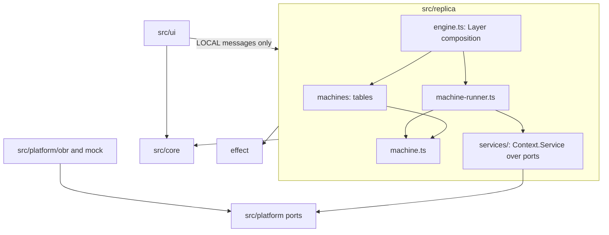

# The replica on Effect and transition tables

Status: proposed, 2026-11-18. Decision record: `docs/adr/0004-the-replica-runs-effect-machines-with-complete-transition-tables.md`. Spike: `prototypes/effect-machine-spike/`.

## Goals, as the owner set them

1. A simpler core: fewer hand-rolled mechanics in `src/replica`.
2. Better errors: a failure has a type, a place that decides what to do with it, and a reader who learns what failed.
3. Completeness of every state machine is checked automatically.

Not goals: a change to any AD rule in the architecture spine, to the wire protocol, to the ports, to `src/core`, `src/ui` or `src/builder`.

## Where the replica stands

Facts measured on `master` at 1aa5fb6:

| Fact | Value |
| --- | --- |
| `src/replica` production lines | 8600 in 21 modules; `engine.ts` 1508, `composers.ts` 1218 |
| Engine test lines | 20700 in 19 `engine-*.test.ts` files, run on the room rig with real timers |
| `stopped` reads | 126 in `src/replica` |
| `console.error` calls | 86 in `src/replica` |
| Shapes of state handling | four: decision list (`catch-up`), injected ports (`generation-flow`, `room-protocol`, `roll-flow`, `room-copy`, `pending-edits`, `dice-extension`), pure router (`command-routing`), wiring (`engine.ts`) |
| Completeness guard | `never` helpers in three modules (`composers`, `pending-edits`, `room-protocol`); none for phase-event pairs |
| Background page | 97 KB gzip (`background` 25, `core` 57, `obr` 14, `send-queue` 1) |

TASK-64 (doc-4) mapped the machines and chose per-module shapes. Its criterion "no shared state-machine runtime" optimised for the smallest change at that time. Goal 3 needs one shape, because a completeness check written once has to apply to every machine.

## The shape

### Layers and dependency rules



| Rule | Enforced by |
| --- | --- |
| Only `src/replica/**` imports `effect` | `no-restricted-imports` in `.oxlintrc.json` for `src/core`, `src/ui`, `src/builder`, `src/platform` |
| A machine module imports `machine.ts` and `src/core`; never a service, a port or another machine | lint override for `src/replica/machines/**` |
| Only `src/replica/services/**` imports `src/platform/ports` | lint override; the engine reaches ports through services |
| An interpreter is the only code that turns an effect into a service call | review; `Match.exhaustive` makes the omission a compile error |

Directory seed:

```text
src/replica/
  machine.ts            # Tagged, Step, Cell, TransitionTable, step()
  machine-runner.ts     # Queue + Ref + interpret loop, one fiber per machine, failure policy
  failures.ts           # Data.TaggedError classes, one per port failure
  services/             # Broadcast, Storage, Party, Player, Metadata, Notification, Clock-free wrappers
  machines/
    catch-up.ts         # phases, events, effects, table      (pilot)
    catch-up.test.ts
    room-protocol.ts
    generation.ts
    room-copy.ts
    pending-edits.ts
    roll.ts
  interpreters/         # one per machine: effect -> Effect<void, Failure, Services>
  engine.ts             # Layer.mergeAll of services + machines; start() returns Scope
tests/support/
  machine-check.ts      # walk every cell, invariants, Mermaid diff
docs/machines/          # generated Mermaid, one file per machine, checked by machine-check
```

### The table type

Proven in the spike (`prototypes/effect-machine-spike/machine.ts`):

```ts
export type Tagged<K extends string> = { readonly kind: K };
export type Step<Phase, Effect> = { readonly phase: Phase; readonly effects: readonly Effect[] };

// 'ignore' is an explicit answer: the machine saw the event and drops it on purpose.
export type Cell<P, E, Phase, Effect> = 'ignore' | ((phase: P, event: E) => Step<Phase, Effect>);

export type TransitionTable<Phase extends Tagged<string>, Event extends Tagged<string>, Effect> = {
  readonly [P in Phase['kind']]: {
    readonly [E in Event['kind']]: Cell<Extract<Phase, { kind: P }>, Extract<Event, { kind: E }>, Phase, Effect>;
  };
};

export function step<Phase extends Tagged<string>, Event extends Tagged<string>, Effect>(
  table: TransitionTable<Phase, Event, Effect>, phase: Phase, event: Event,
): Step<Phase, Effect>;
```

What the type buys: a row per phase kind and a column per event kind, both derived from the unions. Adding a phase or an event without filling its cells is TS2741 (`prototypes/effect-machine-spike/incomplete.ts` holds the `@ts-expect-error` proof). A cell receives the narrowed phase and event, so `phase.active.nonce` needs no guard inside a `catching-up` cell.

What it does not buy: a cell may return a phase of any kind. Which phases a transition may lead to, and which effects a phase may emit, are checked by `machine-check` (below), not by the type.

Module-private state that is not a phase (bounded id sets, digest maps) lives in the phase record, not in closure variables. A machine module exports its table, its unions and nothing stateful.

### The runner

```ts
export type Machine<Phase, Event, Effect, Failure, Services> = {
  readonly name: string;
  readonly table: TransitionTable<Phase, Event, Effect>;
  readonly initial: Phase;
  readonly interpret: (emit: (event: Event) => Effect.Effect<void>) =>
    (effect: Effect) => Effect.Effect<void, Failure, Services>;
  readonly onFailure: (failure: Failure) => FailurePolicy;   // see Errors
};

export type Running<Phase, Event> = {
  readonly send: (event: Event) => Effect.Effect<void>;      // Queue.offer
  readonly phase: Effect.Effect<Phase>;                       // Ref.get, for readers such as `live()`
  readonly changes: Stream.Stream<Phase>;                     // publisher and cross-machine events
};

export const runMachine: <...>(machine: Machine<...>) => Effect.Effect<Running<Phase, Event>, never, Services | Scope.Scope>;
```

The loop is `Queue.take -> Ref.get -> step -> Ref.set -> for each effect: interpret`, forked in the engine's scope. Effects of one step run in order; events of one machine are serialized by the queue, which replaces the `roomMessages` promise chain in `room-protocol`. A timer effect is `Effect.sleep(ms).pipe(Effect.andThen(emit(event)), Effect.forkScoped)`, so the decision is made when the event arrives, as CLAUDE.md requires. A `disarm` effect interrupts the timer's fiber, held in a `Map<TimerKey, Fiber>` inside the interpreter.

Cross-machine seams listed in doc-4 become events. `catch-up` no longer calls `saveAdoption` synchronously inside a step: it enters a phase that waits for `adoption-saved | adoption-failed` from the generation machine. This is the one ordering change in the design; the engine tests for adoption races (`engine-import`, `engine-catch-up`) are the oracle for it.

### Errors

```ts
export class StorageFailure extends Data.TaggedError('StorageFailure')<{ operation: StorageOperation; reason: string; key?: string }> {}
export class SendFailure    extends Data.TaggedError('SendFailure')<{ kind: 'rate-limited' | 'failed'; reason?: string; channel: string; t: string }> {}
export class PartyReadFailure extends Data.TaggedError('PartyReadFailure')<{ cause: unknown }> {}
export class PlayerReadFailure extends Data.TaggedError('PlayerReadFailure')<{ field: 'role' | 'name' | 'id'; cause: unknown }> {}
export class MetadataFailure extends Data.TaggedError('MetadataFailure')<{ operation: 'read' | 'write'; cause: unknown }> {}
export class DiceExtensionFailure extends Data.TaggedError('DiceExtensionFailure')<{ reason: string }> {}
export class NotificationFailure extends Data.TaggedError('NotificationFailure')<{ cause: unknown }> {}
```

Three kinds of outcome, kept apart:

| Kind | Example | Channel |
| --- | --- | --- |
| Expected failure of a port | quota, rate limit, a party read that rejects | the error channel, one tagged class per port failure |
| Domain verdict | `denied`, `stale`, `invalid-message`, `older-version` | a value in the success channel, as today (`Result`, `RejectMessage`) |
| Bug | an unknown command, a cell that returns an impossible phase | `Effect.die`; surfaces in tests, never caught by policy |

A `FailurePolicy` is `{ kind: 'retry'; schedule: Schedule } | { kind: 'notice'; notice: Notice } | { kind: 'log'; level: 'warning' | 'error' } | { kind: 'ignore' }`. Each machine's `onFailure` maps its failure union to a policy with `Match.exhaustive`. The runner applies it in one place, with `Effect.annotateLogs({ machine, phase, effect })`, so a log line names the machine, the phase it was in and the effect that failed. That line replaces 86 `console.error` calls whose text today is the only context.

`Data.TaggedError`, not `Schema.TaggedError`: the latter costs 14 KB gzip more and brings a second schema library beside zod, which `src/core` keeps for the wire and the preset.

### Services over ports

The ports in `src/platform/ports.ts` keep their signatures, because `src/ui` and the port contract tests use them. `src/replica/services/` adapts each one:

```ts
export class Broadcast extends Context.Service<Broadcast, {
  send: (channel: string, data: JsonValue, options: BroadcastOptions) => Effect.Effect<void, SendFailure>;
  messages: (channel: string) => Stream.Stream<BroadcastEvent>;
}>()('muster-roll/replica/Broadcast') {
  static readonly fromPort = (port: BroadcastPort, queue: SendQueue) => Layer.succeed(Broadcast, ...);
}
```

`SendResult` becomes `Effect.fail(new SendFailure(...))`; a `StoragePort` `Result` becomes `Effect.fail(new StorageFailure(...))`; `onMessage` subscriptions become streams whose unsubscribe is a finalizer. The send queue stays where it is; its `enqueue` is wrapped once.

The mock adapter and the OBR adapter are untouched, so TASK-64.3's port contract keeps proving the same thing.

### Lifecycle

`startReplicaEngine` returns a `Scope`. `stop()` closes it: every machine fiber, timer fiber and subscription ends through interruption and finalizers. The 126 `stopped` reads go away; a step that runs after `stop()` cannot run, because its fiber is gone. `flushNow` stays an explicit call: it sends `closing` to the catch-up machine and flushes the outbox and the send queue, as today.

## Machine catalog

The phase and event sets below are the starting point. Each machine's ticket fixes its table from the module tests that exist today, and the table, not this document, is then the source of truth.

| Machine | Phases (kinds) | Events it takes | Effects it emits | Today |
| --- | --- | --- | --- | --- |
| Catch-up and GM link (AD-6, AD-7, AD-9 gate) | `initializing`, `live`, `catching-up/ordinary`, `catching-up/adopting`, `catching-up/saving-adoption` | `enter(trigger)`, `room-copy-read`, `party-read`, `generation-heard`, `generation-read`, `adoption-saved`, `adoption-failed`, `heard`, `state-requested`, `ping`, `alive`, `state-merged`, `timer(kind)`, `closing`, `party-changed`, `replica-replaced` | `arm`, `disarm`, `merge-persisted`, `read-room-copy`, `read-party`, `request`, `answer`, `alive`, `ping`, `caught-up`, `show`, `gm-back`, `save-adoption` | `catch-up.ts`, decisions; closest to the target |
| Room protocol (AD-5) | `idle`, `assembling(proposals)` | `message(event)`, `sender-known`, `timer(retention)` | `admit-failed`, `catch-up-event`, `apply-records`, `reject`, `commit`, `deliver-roll`, `see-generation`, `stage` | `room-protocol.ts`, promise chain |
| Generation and adoption (AD-9) | `settled(g)`, `importing(id)`, `staged(target, records)`, `saving` | `import`, `wipe`, `check-snapshot`, `adopt-from-copy`, `see-generation`, `stage`, `clear-staged`, `save-requested`, `store-written`, `store-failed`, `role-changed` | `write-store`, `remove-store`, `replace-replica`, `write-import`, `send-reset`, `flush-outbox`, `drop-pending`, `notice`, `reply`, `adoption-saved`, `adoption-failed` | `generation-flow.ts`, injected ports |
| Room copy (AD-8) | `idle`, `reading`, `writing`, `verifying`, `stopped` | `edited`, `caught-up`, `page-hidden`, `page-returned`, `timer(pause)`, `read-done`, `write-done`, `verify-done`, `failed` | `read-metadata`, `write-metadata`, `arm`, `publish-status`, `replaced` | `room-copy.ts`, already has `WritePhase` |
| Pending edits (AD-4) | per entry: `waiting`, `sent(attempt)`, `denied-quiet` | `edit`, `answered`, `rejected(stale/denied)`, `gm-back`, `caught-up`, `timer(resend)`, `drain` | `enqueue-propose`, `arm`, `notice-denied`, `publish` | `pending-edits.ts`, injected ports |
| Roll (AD-13) | `idle`, `awaiting-dice(request)` | `roll-request`, `dice-ready`, `dice-result`, `dice-failed`, `roll-received` | `check-dice`, `roll-dice`, `send-roll`, `reply-outcome`, `notify` | `roll-flow.ts`; the ticket may keep it a linear `Effect.gen` if two phases add nothing |

Not machines: `command-routing` stays a pure router (`decideCommandRoute`) called from the engine's command interpreter; `composers`, `record-store`, `version-minter`, `party-roster` and `window-publisher` are libraries or services. The token menu, scene watch and open requests stay engine wiring in the first pass, as doc-4 left them.

## Completeness, checked three ways

1. **Every phase-event pair has a cell.** `TransitionTable` requires it. Spike proof: removing `live.answered` fails `tsc` with TS2741.
2. **Every effect has an interpreter.** `Match.type<Effect>().pipe(Match.discriminator('kind')(...), Match.exhaustive)`. Spike proof: the interpreter compiles only with all three effect kinds handled.
3. **Every cell behaves.** `tests/support/machine-check.ts` takes a machine, a fast-check arbitrary per phase kind and per event kind, an `allowedEffects: Record<Phase['kind'], readonly Effect['kind'][]>` map and a list of invariants `(phase) => boolean`. For every cell it generates data, runs `step`, and asserts: the result phase kind is one of the table's rows; each effect kind is allowed for the result phase; every invariant holds. It also renders the table to Mermaid (`stateDiagram-v2`, one arrow per non-`ignore` cell, labelled with the event) and compares it with `docs/machines/<name>.md`; a stale file fails the test and prints the new text. `fast-check` is already a dev dependency.

Example invariants from today's code: `adopting` implies `catching-up`; `catching-up.active.sentNonce` is `null` or equals `active.nonce`; a `write-metadata` effect appears only from `writing`.

The engine tests stay the behavioral oracle. Optionally, a later ticket adds `fc.commands` model-based runs of two or three machines against the rig.

## Tests and their boundaries

| Level | Runs | Clock | Proves |
| --- | --- | --- | --- |
| Table tests, `src/replica/machines/*.test.ts` | `step()` on the table, no Effect runtime | none | a cell's decision |
| Machine-check, `tests/support/machine-check.ts` | every cell with generated data | none | completeness, invariants, diagram freshness |
| Interpreter tests, `src/replica/interpreters/*.test.ts` | `runMachine` under `Layer.succeed` stubs of the services and `TestClock` | virtual | effect order, timers, failure policy (spike: `TestClock.adjust('20 seconds')` fires the silence timer) |
| Engine tests, `src/replica/engine-*.test.ts` | the rig, mock platform, real clock | real | unchanged room behavior, junit list equal to the baseline per step |
| Port contract, TASK-64.3 | mock and Chromium | real | unchanged |

Interpreter tests on `TestClock` are the first deterministic home for the two-GM timing cases that `deferred-work.md` lists under TASK-48 (mutation M5): the race lives in the rig's real timers, not in the rules.

## Migration

A strangler, one step per PR, the full check and a junit list equal to the baseline on each. Order chosen so that each step has an oracle before it changes anything else:

| Step | Change | Oracle |
| --- | --- | --- |
| 0 | Add `effect`, the lint boundary, `machine.ts`, `machine-runner.ts`, `machine-check.ts`, `docs/machines/`. Rewrite `catch-up.ts` as a table; `runCatchUp` in the engine keeps interpreting its decisions, so the engine does not change | `catch-up.test.ts` (48 tests) and the engine suite |
| 1 | `failures.ts`, `services/`, one failure policy; the engine's `console.error` calls move into interpreters or the sink | engine suite; a count of `console.error` in `src/replica` equal to 0 |
| 2 | Room protocol as a machine on a queue; the `roomMessages` chain goes | `room-protocol.test.ts`, `engine-propose`, `engine-client` |
| 3 | Generation and adoption as a machine; `saveAdoption` becomes the `saving-adoption` phase | `generation-flow.test.ts`, `engine-import`, `engine-catch-up` |
| 4 | Room copy as a machine | `room-copy.test.ts`, `engine-room-copy` |
| 5 | Pending edits and roll | their module tests, `engine-propose`, `engine-roll`, `engine-dice-extension` |
| 6 | `engine.ts` becomes a `Layer` composition and a `Scope`; `stopped` and the stop list go | the whole suite; `grep stopped src/replica` finds only the room-copy phase name |
| 7 | Spine: the Replica row and diagram name `machine-runner`, `services`, `machines`; ADR-0004 to accepted; TASK-63/64 criteria noted as superseded | docs checks |

Each step is one backlog task under one epic, created when the owner accepts the ADR. Steps 2 to 5 are independent of each other once 0 and 1 are in; they can run in separate worktrees as TASK-64 did.

## Risks and what bounds them

| Risk | Bound |
| --- | --- |
| `effect@4` is young (4.1.4) and its API moved from v3 | Pin the exact version; the spike runs on 4.1.4 with TypeScript 7.0.2, the repo's compiler |
| Bundle growth | 17 KB gzip measured on the background page only; `src/ui` and `src/builder` import no Effect, so the window pages do not grow |
| Type-aware oxlint on Effect generics slows `bun run lint` | Measure in step 0; the layer boundary keeps Effect in one directory |
| The adoption ordering change (step 3) | The engine adoption tests are the oracle; the step ships only with the junit list equal |
| A second way to write async code in the repo | The lint boundary keeps it in `src/replica`; ADR-0002 stays the UI shape |
| The owner's earlier decision against a shared runtime | Reversed knowingly in ADR-0004, for goal 3; the runtime is one small module, not a framework |

## Measurements behind this document

From `prototypes/effect-machine-spike/`, run on 2026-11-18 with `effect@4.1.4`, `typescript@7.0.2`, `bun@1.4.4`:

| Check | Result |
| --- | --- |
| `tsc -p tsconfig.json` with the missing-cell file | passes; the missing cell is TS2741 under `@ts-expect-error` |
| `bun run.ts` | `initializing -> catching-up -> live/online`, then `TestClock.adjust('20 seconds')` -> `live/offline` |
| Runtime + Queue + Ref + Match + Layer + Context + `Data.TaggedError` | 17.0 KB gzip (50.4 KB raw) |
| The same with `Schema.TaggedError` | 30.9 KB gzip (93.6 KB raw) |
| Background page today | 97 KB gzip across its four chunks |
